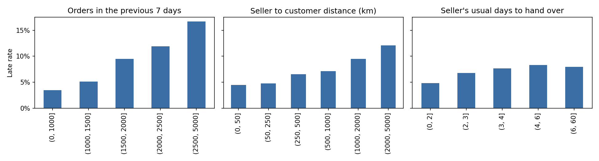
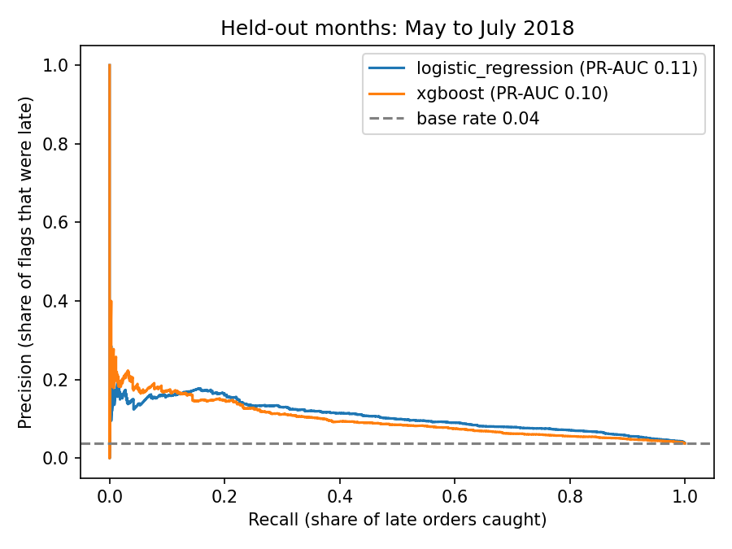
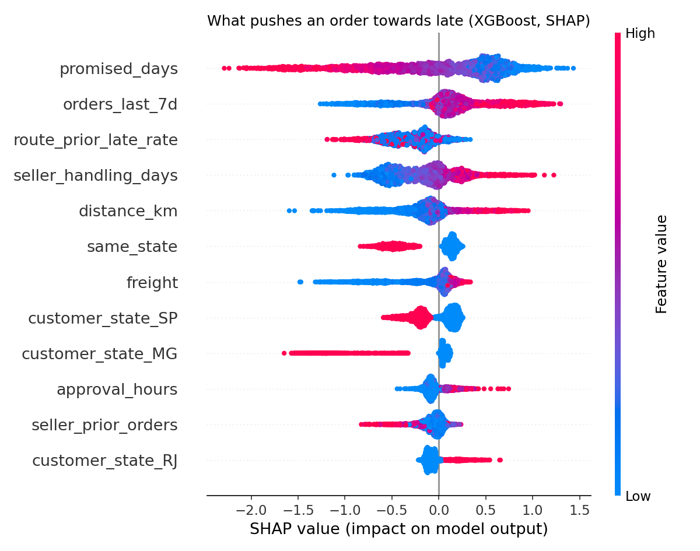

# Late Delivery Predictor

Which marketplace orders will miss their promised delivery date? This project predicts it at the moment an order is
approved, from about 100,000 real orders in the [Olist Brazilian e-commerce dataset](https://www.kaggle.com/datasets/olistbr/brazilian-ecommerce),
explains the drivers with SHAP, and turns them into recommendations an operations team can act on. A FastAPI service
scores new orders.

**Result:** on three months the models never saw, flagging the riskiest 10% of orders catches about a third of the
orders that end up late, and a flagged order is about three times as likely to be late as an average one.



## What makes an order late

6.8% of the 96,189 delivered orders placed from January 2017 to August 2018 arrived after the promised date. The full
analysis is in [`notebooks/late_delivery_story.ipynb`](notebooks/late_delivery_story.ipynb).

- **Marketplace load:** 16.7% of orders arrive late when more than 2,500 orders were placed in the previous seven
  days, against 3.5% below 1,000. Lateness comes in waves: 12.4% in November 2017 and 19.0% in March 2018.
- **Distance:** 12.1% late beyond 2,000 km, 4.5% within 50 km. Crossing a state border moves the rate from 4.5% to 8.1%.
- **Destination:** Rio de Janeiro (12.1%) and Bahia (12.2%) are late almost three times as often as São Paulo (4.5%).
- **Seller speed:** sellers who usually hand orders to the carrier within two days are late 4.8% of the time; those who
  take more than four days, about 8%.
- **Promise length:** orders promised more than 40 days out are late only 2.4% of the time.

## How it works

**Target.** An order is late when it was delivered on a later calendar day than the date promised at checkout.
Only delivered orders are used.

**Features** (`ldp/features.py`), all known when the order is approved:

| Group | Features |
| --- | --- |
| Promise | days from purchase to the promised date, hours to approval, weekday |
| Basket | items, sellers, price, freight, freight-to-price ratio, total weight and volume, main category |
| Geography | seller-to-customer distance (haversine between zip-code centroids, outliers outside Brazil removed), customer and seller state, same-state flag |
| History | the seller's past orders, late rate and usual days to hand over to the carrier; the seller-to-customer route's late rate |
| Load | marketplace orders placed in the previous seven days |

History features never look ahead. For each order they only count earlier orders that had already been delivered (or
handed to the carrier) before this order was placed, using `pandas.merge_asof`. Rates are smoothed towards the
marketplace rate at that time, so a seller with two orders is not scored 0% or 100%. A unit test pins this behaviour.

**Evaluation** (`ldp/train.py`). Logistic regression (class-weighted) and XGBoost (with `scale_pos_weight`) share one
preprocessing pipeline. They are compared with five-fold `TimeSeriesSplit` cross-validation on January 2017 to April
2018, then tested once on May to July 2018. August 2018 is excluded because many of its orders were still in transit
when the data was exported, which would hide late orders. The high-risk threshold is set on February to April 2018
predictions from a model trained on earlier months, so it is never tuned on the data it is judged on.

## Results

Late orders are rare, 7.6% in the training months and 3.8% in the test months, so PR-AUC and the top-10% flag matter
more than accuracy.

| Model | CV ROC-AUC | CV PR-AUC | Test ROC-AUC | Test PR-AUC | Top 10% flagged: precision | Late orders caught |
| --- | --- | --- | --- | --- | --- | --- |
| Logistic regression | 0.674 | 0.171 | **0.758** | **0.106** | **12.4%** | **32.5%** |
| XGBoost | 0.673 | **0.181** | 0.711 | 0.098 | 11.2% | 29.5% |

Numbers come from `reports/metrics.json`, written by the training run.



What the numbers say, and what was learned building them:

- **Simple generalised better.** XGBoost had the higher cross-validated PR-AUC, so it is the model the API serves,
  following the protocol. But logistic regression did better on the calmer test months. With only 16 months of
  history, the simpler model is the safer default.
- **Purchase month was dropped on purpose.** It ranked second in SHAP, but 16 months of data contain each month once
  or twice, so the model was memorising one-off waves rather than seasonality. Removing it cost 0.005 test ROC-AUC
  and made the model rely on causes an operations team can act on.
- **Seller handover time beats seller late rate.** Once handover speed is in the model, a seller's past late rate adds
  almost nothing (logistic weight 0.01 against 0.36).
- **One SHAP surprise.** In XGBoost, a high route late rate pushes the score down once distance, destination and load
  are accounted for, although the riskiest fifth of routes is late about twice as often in both periods. Logistic
  regression keeps the expected positive weight. The features overlap, and the tree model overfits that overlap.



## Recommendations for operations

1. **Pad promises during surges.** When the trailing seven-day order count passes about 2,000, add buffer days to
   cross-state promises. The late rate more than doubles above that volume.
2. **Set promises per route.** Destinations such as Rio de Janeiro, Bahia and Espírito Santo need longer promises
   from São Paulo sellers than intra-state orders do.
3. **Hold sellers to a handover target.** Sellers who take more than three days are late about 60% more often than
   those who hand over within two. A two-day target with a weekly scorecard addresses a cause the marketplace controls.
4. **Work a daily risk list.** Score new orders with the API, flag the riskiest 10%, and update those customers or
   escalate with the carrier before the promised date passes.

## Scoring API

```sh
uvicorn ldp.api:create_app --factory
```

```sh
curl -X POST localhost:8000/predict -H "Content-Type: application/json" -d '{
  "promised_days": 18, "approval_hours": 1.5, "purchase_weekday": 0, "n_items": 1, "n_sellers": 1,
  "price": 129.9, "freight": 38.5, "weight_kg": 2.1, "volume_l": 12, "distance_km": 1450,
  "seller_prior_orders": 120, "seller_prior_late_rate": 0.09, "seller_handling_days": 3.4,
  "route_prior_late_rate": 0.11, "orders_last_7d": 2300, "customer_state": "RJ", "seller_state": "SP",
  "category": "health_beauty"}'
```

The response holds `late_probability` and `high_risk`, which is true when the order falls in the riskiest 10% by the
threshold set during training. Inputs are validated, and an out-of-range field returns `422`. Interactive docs are at
`/docs`.

## Run it

Requirements: Docker, and the [Kaggle CLI](https://github.com/Kaggle/kaggle-api) to fetch the data.

```sh
sh scripts/download_data.sh                 # data/raw, about 120 MB unzipped
docker build -t ldp .
docker run --rm -v "$PWD:/app" ldp python -m ldp.train
docker run --rm -v "$PWD:/app" -w /app/notebooks ldp jupyter nbconvert --to notebook --execute --inplace late_delivery_story.ipynb
docker run --rm -v "$PWD:/app" -p 8000:8000 ldp
```

Training writes `models/model.joblib`, `reports/metrics.json` and the figures in `reports/figures/`.

## Tests

```sh
docker run --rm -v "$PWD:/app" ldp pytest -q
```

The tests cover the distance calculation, the leak-free history (an order never sees deliveries that happened after it
was placed), the rolling order count, and the API (scoring, ordering of risk, and input validation). They use
synthetic data, so CI runs them without the dataset.

## Layout

| Path | Contents |
| --- | --- |
| `ldp/features.py` | Joins the Olist tables and builds leak-free features |
| `ldp/train.py` | Cross-validation, test evaluation, threshold, SHAP and figures |
| `ldp/api.py` | FastAPI scoring service |
| `notebooks/` | The data story, and the script that generates it |
| `reports/` | Metrics and figures from the last training run |
| `tests/` | Unit and API tests |

## Next steps

- Use rolling 90-day histories instead of all-time ones, so seller and route rates recover after a wave.
- Calibrate probabilities, and set the threshold from the cost of a missed late order against the cost of an alert.
- Retrain monthly and alert when the score distribution drifts.

## Data

Olist, *Brazilian E-Commerce Public Dataset by Olist*, Kaggle, licensed CC BY-NC-SA 4.0. The raw data is not included
in this repository; `scripts/download_data.sh` fetches it.
